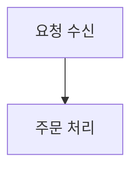
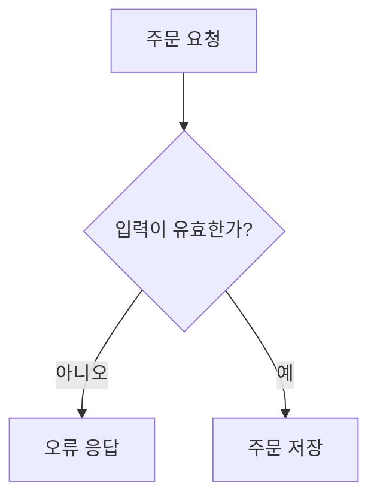
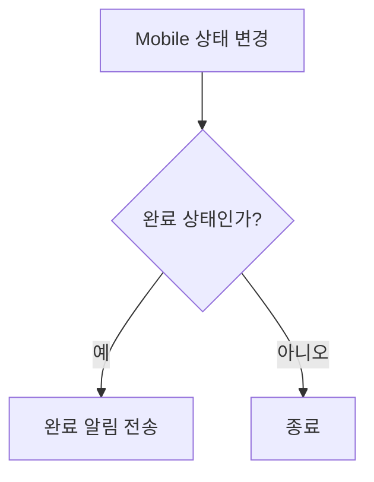

# Project Flow Viewer

프로젝트의 실행 조건·분기·결과를 Mermaid 다이어그램으로 탐색하는 로컬 웹 뷰어입니다. 언어, 프레임워크, AI 공급자를 제한하지 않습니다.

이 저장소는 역할을 분리합니다.

- `prompts/generate-diagrams.md`: 어떤 AI에서도 사용할 수 있는 흐름도 생성 명세
- `skills/project-flow-diagrams/SKILL.md`: 스킬을 지원하는 에이전트용 선택 진입점
- `server.js`와 `public/`: 생성된 `diagrams.md`를 표시하는 AI 없는 로컬 뷰어

## 빠른 시작

### 이미 `diagrams.md`가 있는 경우

```bash
DIAGRAM_SOURCE=/path/to/project/diagrams.md node server.js
```

브라우저에서 [http://localhost:4747](http://localhost:4747)을 엽니다. Node.js 내장 모듈만 사용하므로 패키지 설치가 필요 없습니다.

### 프로젝트 소스에서 흐름도를 생성하는 경우

1. 사용할 AI가 프로젝트 소스를 읽을 수 있게 합니다.
2. `prompts/generate-diagrams.md`를 지침으로 제공합니다.
3. AI가 생성한 `diagrams.md`를 `DIAGRAM_SOURCE`로 지정합니다.
4. 뷰어를 실행합니다.

Codex·Claude처럼 `SKILL.md` 형식의 스킬을 지원하는 환경에서는 `skills/project-flow-diagrams`를 설치하거나 직접 지정할 수 있습니다. 스킬을 지원하지 않는 환경에서는 공통 프롬프트만 사용하면 됩니다.

AI 서비스에 소스를 제공할 때는 조직의 코드·개인정보·기밀정보 반출 정책을 먼저 확인하세요. 뷰어 자체는 AI나 외부 API를 호출하지 않습니다.

## 지원하는 프로젝트

생성 명세는 확장자를 제한하지 않습니다. 웹 앱, API 서버, CLI, 배치, 자동화 스크립트, 데이터 파이프라인 등 소스에서 실행 흐름을 확인할 수 있는 프로젝트를 대상으로 합니다.

뷰어는 소스 코드를 직접 분석하지 않습니다. 아래 형식의 Mermaid Markdown만 읽습니다.

````markdown
## 전체 구조



## src/orders/create-order.ts | 주문 생성


````

- 첫 Mermaid 섹션은 `## 전체 구조`
- 상세 제목은 `## <상대 경로> | <표시명>`
- 상대 경로의 바로 위 폴더명이 사이드바 그룹으로 자동 표시
- 전체 구조의 파일명 또는 표시명 노드를 클릭하면 상세 흐름으로 이동

## 프로젝트별 설정

기본 설정은 `public/viewer.config.js`이며 특정 프로젝트 정보가 없습니다. 개인 또는 조직 설정은 별도 JavaScript 파일로 만들고 환경 변수로 지정합니다.

```bash
VIEWER_CONFIG=/path/to/viewer.config.js \
DIAGRAM_SOURCE=/path/to/diagrams.md \
node server.js
```

저장소 루트에 `viewer.config.local.js`가 있으면 자동으로 사용하며 이 파일은 Git에서 제외됩니다. 설정 선택 순서는 다음과 같습니다.

1. `VIEWER_CONFIG` 환경 변수
2. 저장소 루트의 `viewer.config.local.js`
3. `public/viewer.config.js` 기본값

다이어그램 입력도 같은 원칙으로 분리됩니다.

1. `DIAGRAM_SOURCE` 환경 변수
2. 저장소 루트의 `diagrams.local.md`
3. 저장소의 범용 예제 `diagrams.md`

설정 예시:

```javascript
window.FLOW_VIEWER_CONFIG = {
  ui: {
    eyebrow: 'ORDER PLATFORM',
    title: '주문 플랫폼 흐름',
    overviewTitle: '주문 플랫폼 전체 흐름',
    overviewDescription: '요청 → 결제 → 배송',
    filterLabel: '서비스',
  },
  preferredGroups: ['api', 'workers'],
  filters: {
    items: {
      orders: {
        id: 'orders',
        name: '주문',
        color: '#2563eb',
        soft: '#dbeafe',
        featured: true,
        note: '외부 요청 진입점',
      },
    },
    aliases: [{ keys: ['order', '주문'], item: 'orders' }],
    fileMap: { 'create-order.ts': ['orders'] },
  },
};
```

필터 설정을 생략하면 관련 UI가 자동으로 숨겨지고 순수 Mermaid 뷰어로 작동합니다. `preferredGroups`에 없는 폴더도 다이어그램 경로에서 자동 발견되어 표시됩니다.

Mermaid는 `strict` 보안 수준으로 렌더링합니다. 전체 구조의 드릴다운 이벤트는 Mermaid 문서 안의 실행 지시가 아니라 뷰어 코드가 직접 연결합니다.

## 파일 구성

- `prompts/generate-diagrams.md`: AI 중립 생성 명세의 정본
- `.codex/prompts/generate-diagrams.md`: Codex 프로젝트 프롬프트 호환 진입점
- `skills/project-flow-diagrams/SKILL.md`: 선택적 에이전트 스킬
- `server.js`: 로컬 정적 파일 서버와 Markdown 파서
- `public/index.html`: 화면 구조와 로컬 Mermaid 번들 로드
- `public/app.js`: 탐색, 렌더링, 드릴다운, 선택 필터
- `public/viewer.config.js`: 개인정보나 조직 정보가 없는 기본 설정
- `DESIGN.md`: UI 토큰과 컴포넌트 계약

## 개발 검증

```bash
npm test
npm run check
```

## 테마 · 내보내기 · 서비스 아이콘

- **라이트·다크 테마**: 헤더의 `다크 테마` 버튼으로 전환한다(`?theme=dark`도 가능). 노드는 흰색으로 고정되고 바깥 면만 바뀐다.
- **HTML 내보내기**: `HTML 내보내기` 버튼은 mermaid·CSS·설정·다이어그램 데이터를 모두 넣은 HTML 한 장을 저장한다. 서버·인터넷 없이 `file://`로 열린다.
- **서비스 아이콘(선택)**: 흐름도에 명시한 대상 서비스로 노드 아이콘을 결정한다. `Mobile 상태 변경`처럼 서비스명이 생략되어도 `svc_monday`가 있으면 Monday 아이콘이 표시된다. 서비스 분류가 없는 기존 문서는 서비스명 검색으로 표시한다. 기본 로고는 `public/service-icons.js`, 로고 교체·추가는 설정의 `icons.items`, 끄기는 `icons.enabled: false`다. 줄바꿈·강조와 노드 도형은 보존하며 로고가 없는 서비스는 이름으로 표시한다.

### 대상 서비스와 상세 그룹핑

서비스는 코드를 읽는 사람이 **업무가 발생하거나 읽기·쓰기를 수행하는 대상**을 판단해 원본 Mermaid에 기록한다. 뷰어는 이 분류로 아이콘과 그룹을 함께 만든다. GAS가 Monday 항목을 생성하면 대상은 Monday이고, 내부 조건 비교는 Apps Script다.



- 문법: `class <노드 ID 목록> svc_<서비스 ID>`. 서비스 ID의 `-`는 `_`로 쓴다.
- 주요 ID: `monday`, `apps_script`, `sheets`, `google_chat`, `drive`, `browser`(웹 화면), `openai`(OpenAI API). `none`은 명시적 미지정이다. 사용자 아이콘 ID도 사용할 수 있다.
- 분류가 있는 문서에서는 그 분류만 사용한다. 미지정 노드에 문구 검색으로 서비스를 덧붙이지 않는다. 분류할 노드는 ID와 도형을 명시적으로 정의한다.
- 기존 `subgraph`가 없는 상세 흐름에 서비스별 묶음을 만든다. 기존 전체 구조와 직접 작성한 묶음은 그대로 유지한다. 왕복 연결이 복잡하면 작성자가 단계별 `subgraph`로 읽는 순서를 정할 수 있다.
- 상세에서 노드를 선택하면 실제 분기 이름을 담은 다음 단계 버튼이 나타난다. 버튼을 누르면 해당 노드가 보이는 위치로 이동하며, 이전 단계로 돌아가 다른 분기도 따라갈 수 있다. 캔버스 스크롤과 함께 사용할 수 있다.
- 대상 서비스 중복 지정, 정의되지 않은 노드, 알 수 없는 서비스는 렌더 오류로 표시한다. 로고를 끄더라도 그룹은 유지된다.

## 선(화살표)과 묶음 박스

- **선 모양**: 기본은 기존 Mermaid 곡선(`basis`)이며 연결선과 라벨 위치를 Mermaid가 계산한 그대로 쓴다. `linear`도 Mermaid 원래 경로를 사용하며 점 사이를 직선으로 잇는다. 각 선에서 화살표 방향으로 점선이 흐르고 연결 단계마다 시작 시차를 두는 애니메이션이 기본으로 켜진다. `step`·`rounded`를 명시하면 직각 경로 재배치와 아래 선 스타일을 적용한다.
- **직각 모드 선 종류**: `-->` 주 흐름(파란 1.6px 실선) · `-.->` 보조·배포·비동기(회색 1.4px 점선) · `==>` 핵심 경로(파란 2.4px). 화살촉은 선과 같은 색의 채운 삼각형.
- **직각 모드 선 라벨**: 상자 없는 작은 고정폭 글자. 가로선은 선 위, 세로선은 선 오른쪽에 둔다.
- **묶음(subgraph)**: 옅은 면 + 1.5px 테두리 + 둥근 모서리, 제목은 왼쪽 위. 묶음마다 주황·파랑을 번갈아 쓰고 중첩 묶음은 점선 테두리. 제목에는 서비스 아이콘을 14px, 노드에는 라벨 옆에 18px로 표시한다.
- **설정**: `viewer.config.js`의 `edges.curve`(`basis` 기본, `linear`·`step`·`rounded`)와 `edges.animate`(흐름 애니메이션, 기본 켜짐). `animate: false`로 애니메이션을 끌 수 있다.
- **예제**: `DIAGRAM_SOURCE=examples/groups.md node server.js` — 회사 데이터 없는 subgraph 3개짜리 예제.

선 모양·굵기·색·점선·화살촉·라벨 규칙은 [caru-ini/stack-diagram](https://github.com/caru-ini/stack-diagram)(MIT © caru-ini)의 `references/geometry.md`와 `assets/template.html`을 참고했다. 색·굵기 같은 수치(oklch 토큰을 sRGB hex로 옮긴 값)만 가져왔고 코드는 복사하지 않고 Mermaid 출력에 맞춰 새로 작성했다.

단일 HTML·노드 흰색 고정·렌더링 후 확인 아이디어는 [caru-ini/stack-diagram](https://github.com/caru-ini/stack-diagram)(MIT © caru-ini)을 참고했다. 코드는 복사하지 않고 새로 작성했다.

### 아이콘 출처와 라이선스

- Google Sheets, Google Apps Script, Gmail, Google Drive, Google Calendar, Google Chat, GitHub: [Simple Icons](https://simpleicons.org) v16.36.0, CC0-1.0. 로고 상표권은 각 회사(Google, GitHub)에 있으며 서비스 식별 용도로만 쓴다.
- monday.com, Slack, Webhook, Database: Simple Icons에 없거나(monday.com, Slack) 공식 로고가 아닌 개념이라, 이 저장소에서 직접 그린 단순 도형을 브랜드 색으로 칠해 쓴다. 공식 로고가 아니다.
