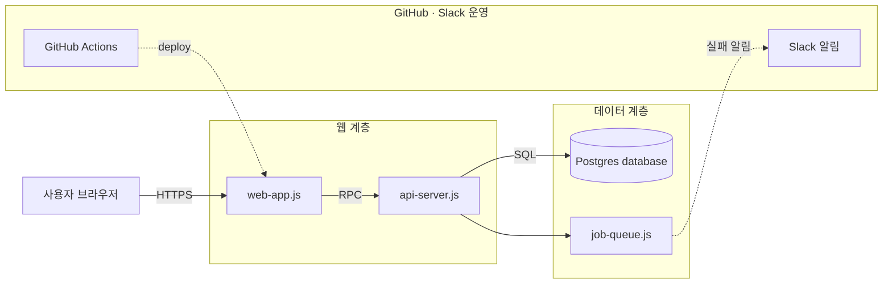
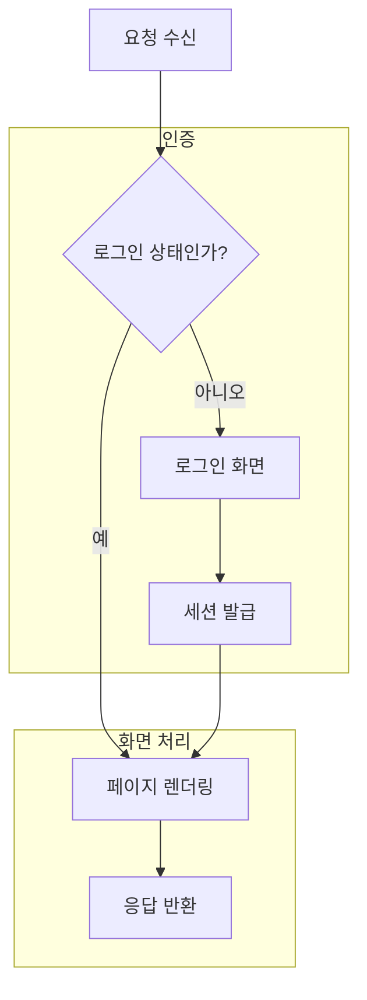
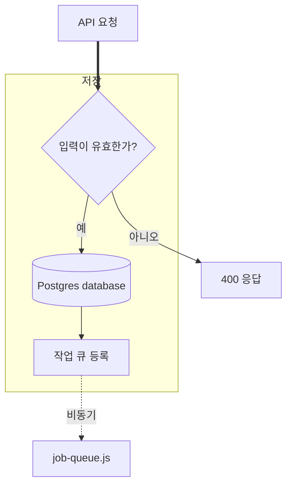
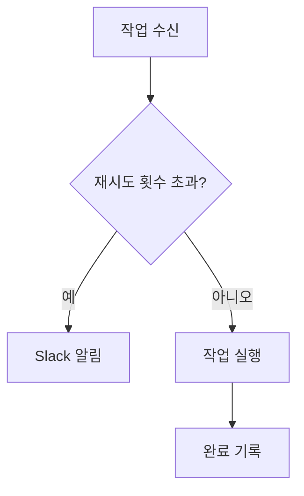

# Subgraph 묶음 예제

회사 데이터 없이 subgraph 묶음 박스·서비스 아이콘·선 종류(실선·점선·굵은 선)를 함께 확인하는 예제다.
`DIAGRAM_SOURCE=examples/groups.md node server.js`로 연다.

## 전체 구조

## src/web/web-app.js | 웹 앱

## src/api/api-server.js | API 서버

## src/jobs/job-queue.js | 작업 큐

